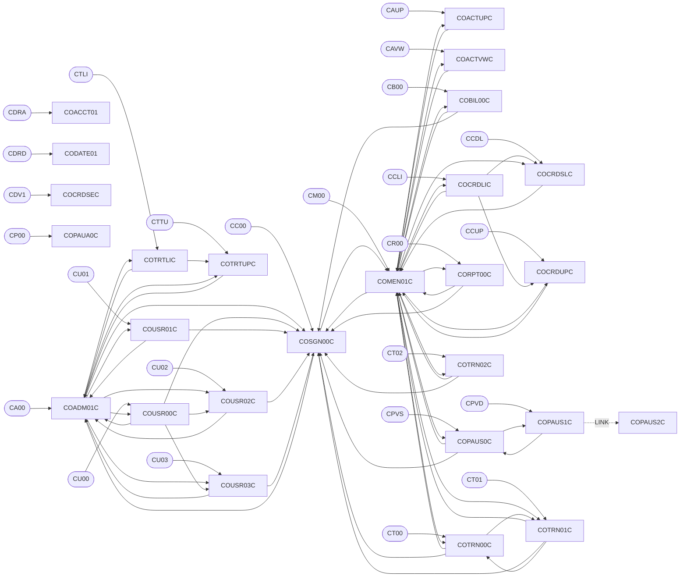
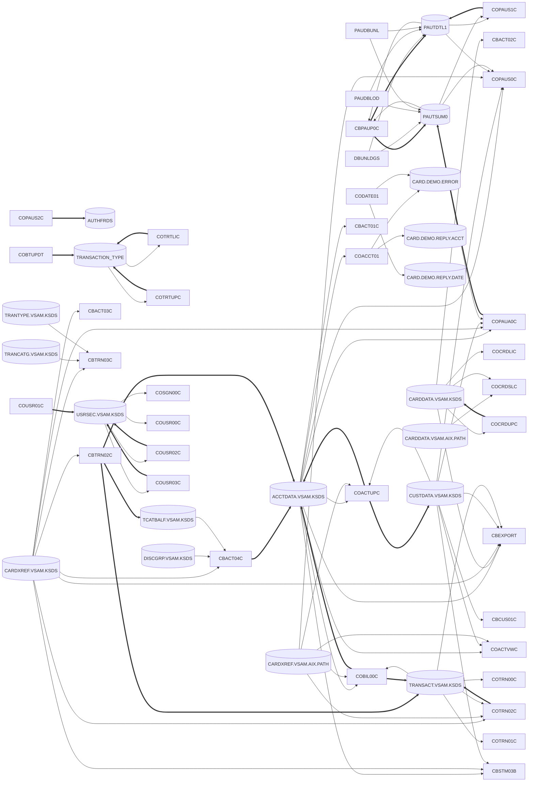

# CardDemo inventory (generated)

<!-- Generated by migration/inventory/build_inventory.py. Do not edit by hand. -->

## Counts

| Kind | Count |
|---|---|
| cics-db2entry | 2 |
| cics-file | 8 |
| cics-library | 2 |
| copybook | 71 |
| ctl | 4 |
| dataset | 229 |
| db2-table | 3 |
| dbd | 4 |
| ims-segment | 3 |
| job | 48 |
| macro | 2 |
| mapset | 21 |
| mq-queue | 4 |
| proc | 2 |
| program | 66 |
| psb | 4 |
| schedule | 4 |
| tdqueue | 2 |
| transaction | 25 |

## Slices

Resources resolve CICS files to their VSAM dataset. Cross-slice lists XCTL/LINK/CALL/submit edges into other slices.

| Slice | Programs | Trans IDs | Mapsets | Reads | Writes | Cross-slice edges |
|---|---|---|---|---|---|---|
| 1-signon-user-admin: Sign-on, menus, user admin | COSGN00C, COMEN01C, COADM01C, COUSR00C, COUSR01C, COUSR02C, COUSR03C | CA00, CC00, CM00, CU00, CU01, CU02, CU03 | COADM01, COMEN01, COSGN00, COUSR00, COUSR01, COUSR02, COUSR03 | USRSEC.VSAM.KSDS | USRSEC.VSAM.KSDS | COADM01C xctl COTRTLIC (5a-txn-type-db2) COADM01C xctl COTRTUPC (5a-txn-type-db2) COMEN01C xctl COACTUPC (2-account-card) COMEN01C xctl COACTVWC (2-account-card) COMEN01C xctl COBIL00C (3-transactions-billing) COMEN01C xctl COCRDLIC (2-account-card) COMEN01C xctl COCRDSLC (2-account-card) COMEN01C xctl COCRDUPC (2-account-card) COMEN01C xctl COPAUS0C (5b-authorization-ims-db2-mq) COMEN01C xctl CORPT00C (3-transactions-billing) COMEN01C xctl COTRN00C (3-transactions-billing) COMEN01C xctl COTRN01C (3-transactions-billing) COMEN01C xctl COTRN02C (3-transactions-billing) |
| 2-account-card: Account and card view/update | COACTVWC, COACTUPC, COCRDLIC, COCRDSLC, COCRDUPC | CAUP, CAVW, CCDL, CCLI, CCUP | COACTUP, COACTVW, COCRDLI, COCRDSL, COCRDUP | ACCTDATA.VSAM.KSDS, CARDDATA.VSAM.AIX.PATH, CARDDATA.VSAM.KSDS, CARDXREF.VSAM.AIX.PATH, CUSTDATA.VSAM.KSDS | ACCTDATA.VSAM.KSDS, CARDDATA.VSAM.KSDS, CUSTDATA.VSAM.KSDS | COACTUPC xctl COMEN01C (1-signon-user-admin) COACTVWC xctl COMEN01C (1-signon-user-admin) COCRDLIC xctl COMEN01C (1-signon-user-admin) COCRDSLC xctl COMEN01C (1-signon-user-admin) COCRDUPC xctl COMEN01C (1-signon-user-admin) |
| 3-transactions-billing: Transactions, bill payment, report request | COTRN00C, COTRN01C, COTRN02C, COBIL00C, CORPT00C, CSUTLDTC | CB00, CR00, CT00, CT01, CT02 | COBIL00, CORPT00, COTRN00, COTRN01, COTRN02 | ACCTDATA.VSAM.KSDS, CARDXREF.VSAM.AIX.PATH, CARDXREF.VSAM.KSDS, TRANSACT.VSAM.KSDS | ACCTDATA.VSAM.KSDS, JOBS, TRANSACT.VSAM.KSDS | COBIL00C xctl COMEN01C (1-signon-user-admin) COBIL00C xctl COSGN00C (1-signon-user-admin) CORPT00C submits TRANREPT (job) CORPT00C xctl COMEN01C (1-signon-user-admin) CORPT00C xctl COSGN00C (1-signon-user-admin) COTRN00C xctl COMEN01C (1-signon-user-admin) COTRN00C xctl COSGN00C (1-signon-user-admin) COTRN01C xctl COMEN01C (1-signon-user-admin) COTRN01C xctl COSGN00C (1-signon-user-admin) COTRN02C xctl COMEN01C (1-signon-user-admin) COTRN02C xctl COSGN00C (1-signon-user-admin) |
| 4-batch: Batch jobs | CBACT01C, CBACT02C, CBACT03C, CBACT04C, CBCUS01C, CBTRN01C, CBTRN02C, CBTRN03C, CBSTM03A, CBSTM03B, CBEXPORT, CBIMPORT, COBSWAIT, MVSWAIT, COBDATFT |  |  | ACCTDATA.VSAM.KSDS, CARDDATA.VSAM.KSDS, CARDXREF.VSAM.KSDS, CUSTDATA.VSAM.KSDS, DALYTRAN.PS, DATEPARM, DISCGRP.VSAM.KSDS, EXPORT.DATA, TCATBALF.VSAM.KSDS, TRANCATG.VSAM.KSDS, TRANSACT.DALY, TRANSACT.VSAM.KSDS, TRANTYPE.VSAM.KSDS, TRXFL.VSAM.KSDS | ACCTDATA.ARRYPS, ACCTDATA.IMPORT, ACCTDATA.PSCOMP, ACCTDATA.VBPS, ACCTDATA.VSAM.KSDS, CARDXREF.IMPORT, CUSTDATA.IMPORT, DALYREJS, EXPORT.DATA, IMPORT.ERRORS, STATEMNT.HTML, STATEMNT.PS, SYSTRAN, TCATBALF.VSAM.KSDS, TRANREPT, TRANSACT.IMPORT, TRANSACT.VSAM.KSDS |  |
| 5a-txn-type-db2: Optional: transaction types on Db2 | COTRTLIC, COTRTUPC, COBTUPDT | CTLI, CTTU | COTRTLI, COTRTUP | INPFILE, TRANSACTION_TYPE | TRANSACTION_TYPE | COTRTLIC xctl COADM01C (1-signon-user-admin) COTRTUPC xctl COADM01C (1-signon-user-admin) |
| 5b-authorization-ims-db2-mq: Optional: pending authorizations on IMS/Db2/MQ | COPAUA0C, COPAUS0C, COPAUS1C, COPAUS2C, CBPAUP0C, DBUNLDGS, PAUDBLOD, PAUDBUNL | CP00, CPVD, CPVS | COPAU00, COPAU01 | ACCTDATA.VSAM.KSDS, CARDXREF.VSAM.AIX.PATH, CARDXREF.VSAM.KSDS, CUSTDATA.VSAM.KSDS, PAUTDB.CHILD.FILEO, PAUTDB.ROOT.FILEO, PAUTDTL1, PAUTSUM0 | AUTHFRDS, CSSL, PAUTDB.CHILD.FILEO, PAUTDB.ROOT.FILEO, PAUTDTL1, PAUTSUM0 | COPAUS0C xctl COMEN01C (1-signon-user-admin) COPAUS0C xctl COSGN00C (1-signon-user-admin) |
| 5c-vsam-mq: Optional: account/date inquiry over MQ | COACCT01, CODATE01 | CDRA, CDRD |  | ACCTDATA.VSAM.KSDS | CARD.DEMO.ERROR, CARD.DEMO.REPLY.ACCT, CARD.DEMO.REPLY.DATE |  |

## Online programs (CICS)

Access codes: R read, W write, U update, D delete. `uses` edges without a direction show as U.

| Program | Module | Slice | Trans IDs | Mapsets | XCTL / LINK to | CALLs | Data access |
|---|---|---|---|---|---|---|---|
| COPAUA0C | app-authorization-ims-db2-mq | 5b-authorization-ims-db2-mq | CP00 |  |  | MQCLOSE, MQGET, MQOPEN, MQPUT1 | ACCTDAT (ACCTDATA.VSAM.KSDS) [R], CCXREF (CARDXREF.VSAM.KSDS) [R], CUSTDAT (CUSTDATA.VSAM.KSDS) [R], PAUTSUM0 [RUW], CSSL [W] |
| COPAUS0C | app-authorization-ims-db2-mq | 5b-authorization-ims-db2-mq | CPVS | COPAU00 | COMEN01C, COPAUS1C, COSGN00C |  | ACCTDAT (ACCTDATA.VSAM.KSDS) [R], CUSTDAT (CUSTDATA.VSAM.KSDS) [R], CXACAIX (CARDXREF.VSAM.AIX.PATH) [R], PAUTDTL1 [R], PAUTSUM0 [R] |
| COPAUS1C | app-authorization-ims-db2-mq | 5b-authorization-ims-db2-mq | CPVD | COPAU01 | COPAUS0C, COPAUS2C (LINK) |  | PAUTDTL1 [RU], PAUTSUM0 [R] |
| COPAUS2C | app-authorization-ims-db2-mq | 5b-authorization-ims-db2-mq |  |  |  |  | AUTHFRDS [UW] |
| COTRTLIC | app-transaction-type-db2 | 5a-txn-type-db2 | CTLI | COTRTLI | COADM01C, COTRTUPC |  | TRANSACTION_TYPE [DRU] |
| COTRTUPC | app-transaction-type-db2 | 5a-txn-type-db2 | CTTU | COTRTUP | COADM01C |  | TRANSACTION_TYPE [DRUW] |
| COACCT01 | app-vsam-mq | 5c-vsam-mq | CDRA |  |  | MQCLOSE, MQGET, MQOPEN, MQPUT | ACCTDAT (ACCTDATA.VSAM.KSDS) [R], CARD.DEMO.ERROR [U], CARD.DEMO.REPLY.ACCT [U] |
| CODATE01 | app-vsam-mq | 5c-vsam-mq | CDRD |  |  | MQCLOSE, MQGET, MQOPEN, MQPUT | CARD.DEMO.ERROR [U], CARD.DEMO.REPLY.DATE [U] |
| COACTUPC | core | 2-account-card | CAUP | COACTUP | COMEN01C |  | ACCTDAT (ACCTDATA.VSAM.KSDS) [RU], CUSTDAT (CUSTDATA.VSAM.KSDS) [RU], CXACAIX (CARDXREF.VSAM.AIX.PATH) [R] |
| COACTVWC | core | 2-account-card | CAVW | COACTVW | COMEN01C |  | ACCTDAT (ACCTDATA.VSAM.KSDS) [R], CUSTDAT (CUSTDATA.VSAM.KSDS) [R], CXACAIX (CARDXREF.VSAM.AIX.PATH) [R] |
| COADM01C | core | 1-signon-user-admin | CA00 | COADM01 | COSGN00C, COTRTLIC, COTRTUPC, COUSR00C, COUSR01C, COUSR02C, COUSR03C |  |  |
| COBIL00C | core | 3-transactions-billing | CB00 | COBIL00 | COMEN01C, COSGN00C |  | ACCTDAT (ACCTDATA.VSAM.KSDS) [RU], CXACAIX (CARDXREF.VSAM.AIX.PATH) [R], TRANSACT (TRANSACT.VSAM.KSDS) [RW] |
| COCRDLIC | core | 2-account-card | CCLI | COCRDLI | COCRDSLC, COCRDUPC, COMEN01C |  | CARDDAT (CARDDATA.VSAM.KSDS) [R] |
| COCRDSLC | core | 2-account-card | CCDL | COCRDSL | COMEN01C |  | CARDAIX (CARDDATA.VSAM.AIX.PATH) [R], CARDDAT (CARDDATA.VSAM.KSDS) [R] |
| COCRDUPC | core | 2-account-card | CCUP | COCRDUP | COMEN01C |  | CARDDAT (CARDDATA.VSAM.KSDS) [RU] |
| COMEN01C | core | 1-signon-user-admin | CM00 | COMEN01 | COACTUPC, COACTVWC, COBIL00C, COCRDLIC, COCRDSLC, COCRDUPC, COPAUS0C, CORPT00C, COSGN00C, COTRN00C, COTRN01C, COTRN02C |  |  |
| CORPT00C | core | 3-transactions-billing | CR00 | CORPT00 | COMEN01C, COSGN00C | CSUTLDTC, submits PROC TRANREPT | JOBS [W] |
| COSGN00C | core | 1-signon-user-admin | CC00 | COSGN00 | COADM01C, COMEN01C |  | USRSEC (USRSEC.VSAM.KSDS) [R] |
| COTRN00C | core | 3-transactions-billing | CT00 | COTRN00 | COMEN01C, COSGN00C, COTRN01C |  | TRANSACT (TRANSACT.VSAM.KSDS) [R] |
| COTRN01C | core | 3-transactions-billing | CT01 | COTRN01 | COMEN01C, COSGN00C, COTRN00C |  | TRANSACT (TRANSACT.VSAM.KSDS) [R] |
| COTRN02C | core | 3-transactions-billing | CT02 | COTRN02 | COMEN01C, COSGN00C | CSUTLDTC | CCXREF (CARDXREF.VSAM.KSDS) [R], CXACAIX (CARDXREF.VSAM.AIX.PATH) [R], TRANSACT (TRANSACT.VSAM.KSDS) [RW] |
| COUSR00C | core | 1-signon-user-admin | CU00 | COUSR00 | COADM01C, COSGN00C, COUSR02C, COUSR03C |  | USRSEC (USRSEC.VSAM.KSDS) [R] |
| COUSR01C | core | 1-signon-user-admin | CU01 | COUSR01 | COADM01C, COSGN00C |  | USRSEC (USRSEC.VSAM.KSDS) [W] |
| COUSR02C | core | 1-signon-user-admin | CU02 | COUSR02 | COADM01C, COSGN00C |  | USRSEC (USRSEC.VSAM.KSDS) [RU] |
| COUSR03C | core | 1-signon-user-admin | CU03 | COUSR03 | COADM01C, COSGN00C |  | USRSEC (USRSEC.VSAM.KSDS) [DR] |

## Batch programs and subroutines

| Program | Type | Module | Slice | Run by jobs | CALLs | Data access |
|---|---|---|---|---|---|---|
| CBPAUP0C | batch (COBOL) | app-authorization-ims-db2-mq | 5b-authorization-ims-db2-mq | CBPAUP0J |  | PAUTDTL1 [DR], PAUTSUM0 [DR] |
| DBUNLDGS | batch (COBOL) | app-authorization-ims-db2-mq | 5b-authorization-ims-db2-mq | UNLDGSAM | CBLTDLI | PAUTDTL1 [U], PAUTSUM0 [U] |
| PAUDBLOD | batch (COBOL) | app-authorization-ims-db2-mq | 5b-authorization-ims-db2-mq | LOADPADB | CBLTDLI | PAUTDB.CHILD.FILEO [R], PAUTDB.ROOT.FILEO [R], PAUTDTL1 [U], PAUTSUM0 [U] |
| PAUDBUNL | batch (COBOL) | app-authorization-ims-db2-mq | 5b-authorization-ims-db2-mq | UNLDPADB | CBLTDLI | PAUTDB.CHILD.FILEO [W], PAUTDB.ROOT.FILEO [W], PAUTDTL1 [U], PAUTSUM0 [U] |
| COBTUPDT | batch (COBOL) | app-transaction-type-db2 | 5a-txn-type-db2 | MNTTRDB2 |  | INPFILE [R], TRANSACTION_TYPE [DUW] |
| CBACT01C | batch (COBOL) | core | 4-batch | READACCT | CEE3ABD, COBDATFT | ACCTDATA.ARRYPS [W], ACCTDATA.PSCOMP [W], ACCTDATA.VBPS [W], ACCTDATA.VSAM.KSDS [R] |
| CBACT02C | batch (COBOL) | core | 4-batch | READCARD | CEE3ABD | CARDDATA.VSAM.KSDS [R] |
| CBACT03C | batch (COBOL) | core | 4-batch | READXREF | CEE3ABD | CARDXREF.VSAM.KSDS [R] |
| CBACT04C | batch (COBOL) | core | 4-batch | INTCALC | CEE3ABD | ACCTDATA.VSAM.KSDS [U], CARDXREF.VSAM.KSDS [R], DISCGRP.VSAM.KSDS [R], SYSTRAN [W], TCATBALF.VSAM.KSDS [R] |
| CBCUS01C | batch (COBOL) | core | 4-batch | READCUST | CEE3ABD | CUSTDATA.VSAM.KSDS [R] |
| CBEXPORT | batch (COBOL) | core | 4-batch | CBEXPORT | CEE3ABD | ACCTDATA.VSAM.KSDS [R], CARDDATA.VSAM.KSDS [R], CARDXREF.VSAM.KSDS [R], CUSTDATA.VSAM.KSDS [R], EXPORT.DATA [W], TRANSACT.VSAM.KSDS [R] |
| CBIMPORT | batch (COBOL) | core | 4-batch | CBIMPORT | CEE3ABD | ACCTDATA.IMPORT [W], CARDXREF.IMPORT [W], CUSTDATA.IMPORT [W], EXPORT.DATA [R], IMPORT.ERRORS [W], TRANSACT.IMPORT [W] |
| CBSTM03A | batch (COBOL) | core | 4-batch | CREASTMT | CBSTM03B, CEE3ABD | STATEMNT.HTML [W], STATEMNT.PS [W] |
| CBSTM03B | subroutine (COBOL) | core | 4-batch |  (called by CBSTM03A) |  | ACCTDATA.VSAM.KSDS [R], CARDXREF.VSAM.KSDS [R], CUSTDATA.VSAM.KSDS [R], TRXFL.VSAM.KSDS [R] |
| CBTRN01C | batch (COBOL) | core | 4-batch |  | CEE3ABD |  DDs (no JCL binds them): ACCTFILE[R], CARDFILE[R], CUSTFILE[R], DALYTRAN[R], TRANFILE[R], XREFFILE[R] |
| CBTRN02C | batch (COBOL) | core | 4-batch | POSTTRAN | CEE3ABD | ACCTDATA.VSAM.KSDS [U], CARDXREF.VSAM.KSDS [R], DALYREJS [W], DALYTRAN.PS [R], TCATBALF.VSAM.KSDS [U], TRANSACT.VSAM.KSDS [W] |
| CBTRN03C | batch (COBOL) | core | 4-batch | TRANREPT | CEE3ABD | CARDXREF.VSAM.KSDS [R], DATEPARM [R], TRANCATG.VSAM.KSDS [R], TRANREPT [W], TRANSACT.DALY [R], TRANTYPE.VSAM.KSDS [R] |
| COBDATFT | subroutine (Assembler) | core | 4-batch |  (called by CBACT01C) |  |  |
| COBSWAIT | batch (COBOL) | core | 4-batch | WAITSTEP | MVSWAIT |  |
| CSUTLDTC | subroutine (COBOL) | core | 3-transactions-billing |  (called by CORPT00C, COTRN02C) | CEEDAYS |  |
| MVSWAIT | subroutine (Assembler) | core | 4-batch |  (called by COBSWAIT) |  |  |

## Programs without source or outside the repo

| Program | Type | Referenced by |
|---|---|---|
| CBLTDLI | external (IMS DL/I) | DBUNLDGS, PAUDBLOD, PAUDBUNL |
| CEE3ABD | external (LE runtime) | CBACT01C, CBACT02C, CBACT03C, CBACT04C, CBCUS01C, CBEXPORT, CBIMPORT, CBSTM03A, CBTRN01C, CBTRN02C, CBTRN03C |
| CEEDAYS | external (LE runtime) | CSUTLDTC |
| DFHCSDUP | external (CICS CSD utility) | CBADMCDJ |
| DFSRRC00 | external (IMS region controller) | DBPAUTP0 |
| DSNTIAUL | external (Db2 utility) | TRANEXTR |
| FTP | external (z/OS utility) | FTPJCL |
| IDCAMS | external (z/OS utility) | ACCTFILE, CARDFILE, CBEXPORT, COMBTRAN, CREASTMT, CUSTFILE, DALYREJS, DEFCUST, DEFGDGB, DEFGDGD, DISCGRP, DUSRSECJ, ESDSRRDS, INTRDRJ1, INTRDRJ2, PRTCATBL, REPROC, REPTFILE, TCATBALF, TRANBKP, TRANCATG, TRANFILE, TRANIDX, TRANREPT, TRANTYPE, XREFFILE |
| IEBGENER | external (z/OS utility) | DEFGDGD, DUSRSECJ, ESDSRRDS, INTRDRJ1, TRANEXTR |
| IEFBR14 | external (z/OS utility) | CREADB21, CREASTMT, DBPAUTP0, DUSRSECJ, ESDSRRDS, PRTCATBL, READACCT, TRANEXTR, UNLDPADB |
| IKJEFT01 | external (TSO batch) | CREADB21 |
| IKJEFT1B | external (TSO batch) | TXT2PDF1 |
| MQCLOSE | external (IBM MQ) | COACCT01, CODATE01, COPAUA0C |
| MQGET | external (IBM MQ) | COACCT01, CODATE01, COPAUA0C |
| MQOPEN | external (IBM MQ) | COACCT01, CODATE01, COPAUA0C |
| MQPUT | external (IBM MQ) | COACCT01, CODATE01 |
| MQPUT1 | external (IBM MQ) | COPAUA0C |
| SDSF | external (z/OS utility) | CARDFILE, CLOSEFIL, CUSTFILE, OPENFIL, TRANFILE |
| SORT | external (z/OS utility) | COMBTRAN, CREASTMT, PRTCATBL, TRANREPT |
| COCRDSEC | missing-source | CDV1 |

## Transactions

| Trans ID | Program | Module | Description |
|---|---|---|---|
| CA00 | COADM01C | core |  |
| CAUP | COACTUPC | core | CREDIT CARD DEMO ACCOUNT UPDATE |
| CAVW | COACTVWC | core |  |
| CB00 | COBIL00C | core |  |
| CC00 | COSGN00C | core |  |
| CCDL | COCRDSLC | core |  |
| CCLI | COCRDLIC | core |  |
| CCUP | COCRDUPC | core | CREDIT CARD UPDATE TRANSACTION |
| CDRA | COACCT01 | app-vsam-mq |  |
| CDRD | CODATE01 | app-vsam-mq |  |
| CDV1 | COCRDSEC | core | DEVELOPER TRANSACTION - 1 |
| CM00 | COMEN01C | core |  |
| CP00 | COPAUA0C | app-authorization-ims-db2-mq |  |
| CPVD | COPAUS1C | app-authorization-ims-db2-mq |  |
| CPVS | COPAUS0C | app-authorization-ims-db2-mq |  |
| CR00 | CORPT00C | core |  |
| CT00 | COTRN00C | core |  |
| CT01 | COTRN01C | core |  |
| CT02 | COTRN02C | core |  |
| CTLI | COTRTLIC | app-transaction-type-db2 |  |
| CTTU | COTRTUPC | app-transaction-type-db2 |  |
| CU00 | COUSR00C | core |  |
| CU01 | COUSR01C | core |  |
| CU02 | COUSR02C | core |  |
| CU03 | COUSR03C | core |  |

## BMS mapsets

| Mapset | Maps | Named fields | Used by |
|---|---|---|---|
| COACTUP | CACTUPA | 54 | COACTUPC |
| COACTVW | CACTVWA | 37 | COACTVWC |
| COADM01 | COADM1A | 20 | COADM01C |
| COBIL00 | COBIL0A | 10 | COBIL00C |
| COCRDLI | CCRDLIA | 45 | COCRDLIC |
| COCRDSL | CCRDSLA | 15 | COCRDSLC |
| COCRDUP | CCRDUPA | 17 | COCRDUPC |
| COMEN01 | COMEN1A | 20 | COMEN01C |
| COPAU00 | COPAU0A | 62 | COPAUS0C |
| COPAU01 | COPAU1A | 27 | COPAUS1C |
| CORPT00 | CORPT0A | 17 | CORPT00C |
| COSGN00 | COSGN0A | 11 | COSGN00C |
| COTRN00 | COTRN0A | 59 | COTRN00C |
| COTRN01 | COTRN1A | 21 | COTRN01C |
| COTRN02 | COTRN2A | 21 | COTRN02C |
| COTRTLI | CTRTLIA | 40 | COTRTLIC |
| COTRTUP | CTRTUPA | 15 | COTRTUPC |
| COUSR00 | COUSR0A | 59 | COUSR00C |
| COUSR01 | COUSR1A | 12 | COUSR01C |
| COUSR02 | COUSR2A | 12 | COUSR02C |
| COUSR03 | COUSR3A | 11 | COUSR03C |

## VSAM datasets and CICS files

| Dataset | Type | Key len / offset | Max LRECL | CICS files | Record layouts | Online users | Batch users |
|---|---|---|---|---|---|---|---|
| ACCTDATA.VSAM.KSDS | KSDS | 11 / 0 | 300 | ACCTDAT | CVACT01Y | COACCT01, COACTUPC, COACTVWC, COBIL00C, COPAUA0C, COPAUS0C | CBACT01C, CBACT04C, CBEXPORT, CBSTM03B, CBTRN02C |
| CARDDATA.VSAM.AIX | AIX over CARDDATA.VSAM.KSDS | 11 / 5 | 150 |  |  |  |  |
| CARDDATA.VSAM.AIX.PATH | PATH over CARDDATA.VSAM.AIX |  |  | CARDAIX | CVACT02Y | COCRDSLC |  |
| CARDDATA.VSAM.KSDS | KSDS | 16 / 0 | 150 | CARDDAT | CVACT02Y | COCRDLIC, COCRDSLC, COCRDUPC | CBACT02C, CBEXPORT |
| CARDXREF.VSAM.AIX | AIX over CARDXREF.VSAM.KSDS | 11 / 5 | 50 |  |  |  |  |
| CARDXREF.VSAM.AIX.PATH | PATH over CARDXREF.VSAM.AIX |  |  | CXACAIX | CVACT03Y | COACTUPC, COACTVWC, COBIL00C, COPAUS0C, COTRN02C |  |
| CARDXREF.VSAM.KSDS | KSDS | 16 / 0 | 50 | CCXREF | CVACT03Y | COPAUA0C, COTRN02C | CBACT03C, CBACT04C, CBEXPORT, CBSTM03B, CBTRN02C, CBTRN03C |
| CUSTDATA.VSAM.KSDS | KSDS | 9 / 0 | 500 | CUSTDAT | CVCUS01Y | COACTUPC, COACTVWC, COPAUA0C, COPAUS0C | CBCUS01C, CBEXPORT, CBSTM03B |
| DISCGRP.VSAM.KSDS | KSDS | 16 / 0 | 50 |  | CVTRA02Y |  | CBACT04C |
| TCATBALF.VSAM.KSDS | KSDS | 17 / 0 | 50 |  | CVTRA01Y |  | CBACT04C, CBTRN02C |
| TRANCATG.VSAM.KSDS | KSDS | 6 / 0 | 60 |  | CVTRA04Y |  | CBTRN03C |
| TRANSACT.VSAM.AIX | AIX over TRANSACT.VSAM.KSDS | 26 / 5 | 350 |  |  |  |  |
| TRANSACT.VSAM.AIX.PATH | PATH over TRANSACT.VSAM.AIX |  |  |  |  |  |  |
| TRANSACT.VSAM.KSDS | KSDS | 16 / 0 | 350 | TRANSACT | CVTRA05Y | COBIL00C, COTRN00C, COTRN01C, COTRN02C | CBEXPORT, CBTRN02C |
| TRANTYPE.VSAM.KSDS | KSDS | 2 / 0 | 60 |  | CVTRA03Y |  | CBTRN03C |
| USRSEC.VSAM.KSDS | KSDS | 8 / 0 | 80 | USRSEC | CSUSR01Y | COSGN00C, COUSR00C, COUSR01C, COUSR02C, COUSR03C |  |

## Db2, IMS, MQ and TD queue resources

| Resource | Kind | Module | Used by (access) |
|---|---|---|---|
| AUTHFRDS | db2-table | app-authorization-ims-db2-mq | COPAUS2C (update/write) |
| TRANSACTION_TYPE | db2-table | app-transaction-type-db2 | COBTUPDT (delete/update/write), COTRTLIC (delete/read/update), COTRTUPC (delete/read/update/write) |
| TRANSACTION_TYPE_CATEGORY | db2-table | app-transaction-type-db2 |  |
| DBPAUTP0 | dbd | app-authorization-ims-db2-mq |  |
| DBPAUTX0 | dbd | app-authorization-ims-db2-mq |  |
| PADFLDBD | dbd | app-authorization-ims-db2-mq |  |
| PASFLDBD | dbd | app-authorization-ims-db2-mq |  |
| PAUTDTL1 | ims-segment | app-authorization-ims-db2-mq | CBPAUP0C (delete/read), COPAUS0C (read), COPAUS1C (read/update), DBUNLDGS (uses), PAUDBLOD (uses), PAUDBUNL (uses) |
| PAUTINDX | ims-segment | app-authorization-ims-db2-mq |  |
| PAUTSUM0 | ims-segment | app-authorization-ims-db2-mq | CBPAUP0C (delete/read), COPAUA0C (read/update/write), COPAUS0C (read), COPAUS1C (read), DBUNLDGS (uses), PAUDBLOD (uses), PAUDBUNL (uses) |
| (trigger queue) | mq-queue |  | COACCT01 (triggered-by), CODATE01 (triggered-by), COPAUA0C (triggered-by) |
| CARD.DEMO.ERROR | mq-queue |  | COACCT01 (uses), CODATE01 (uses) |
| CARD.DEMO.REPLY.ACCT | mq-queue |  | COACCT01 (uses) |
| CARD.DEMO.REPLY.DATE | mq-queue |  | CODATE01 (uses) |
| DLIGSAMP | psb | app-authorization-ims-db2-mq | DBUNLDGS (schedules) |
| PAUTBUNL | psb | app-authorization-ims-db2-mq | PAUDBUNL (schedules) |
| PSBPAUTB | psb | app-authorization-ims-db2-mq | CBPAUP0C (schedules), COPAUA0C (schedules), COPAUS0C (schedules), COPAUS1C (schedules), PAUDBLOD (schedules) |
| PSBPAUTL | psb | app-authorization-ims-db2-mq |  |
| CSSL | tdqueue |  | COPAUA0C (write) |
| JOBS | tdqueue | core | CORPT00C (write) |

## JCL jobs

| Job | Module | Slice | Steps (program) | Datasets written by the job or its programs |
|---|---|---|---|---|
| ACCTFILE | core | 0-data-layer | STEP05=IDCAMS, STEP10=IDCAMS, STEP15=IDCAMS | ACCTDATA.VSAM.KSDS |
| CARDFILE | core | 0-data-layer | CLCIFIL=SDSF, STEP05=IDCAMS, STEP10=IDCAMS, STEP15=IDCAMS, STEP40=IDCAMS, STEP50=IDCAMS, STEP60=IDCAMS, OPCIFIL=SDSF | CARDDATA.VSAM.AIX, CARDDATA.VSAM.AIX.PATH, CARDDATA.VSAM.KSDS |
| CBADMCDJ | core | 0-data-layer | STEP1=DFHCSDUP |  |
| CBEXPORT | core | 4-batch | STEP01=IDCAMS, STEP02=CBEXPORT | EXPORT.DATA |
| CBIMPORT | core | 4-batch | STEP01=CBIMPORT | ACCTDATA.IMPORT, CARDXREF.IMPORT, CUSTDATA.IMPORT, IMPORT.ERRORS, TRANSACT.IMPORT |
| CBPAUP0J | app-authorization-ims-db2-mq | 5b-authorization-ims-db2-mq | STEP01=DFSRRC00 |  |
| CLOSEFIL | core | 4-batch | CLCIFIL=SDSF |  |
| CLOSEFIL1 | (no JCL in repo; named by the CA-7 schedule) |  |  |  |
| CLOSEFIL2 | (no JCL in repo; named by the CA-7 schedule) |  |  |  |
| COMBTRAN | core | 4-batch | STEP05R=SORT, STEP10=IDCAMS | TRANSACT.COMBINED, TRANSACT.VSAM.KSDS |
| CREADB21 | app-transaction-type-db2 | 5a-txn-type-db2 | FREEPLN=IKJEFT01, CRCRDDB=IKJEFT01, LDTTYPE=IEFBR14, RUNTEP2=IKJEFT01, LDTCCAT=IKJEFT01 |  |
| CREASTMT | core | 4-batch | DELDEF01=IDCAMS, STEP010=SORT, STEP020=IDCAMS, STEP030=IEFBR14, STEP040=CBSTM03A | STATEMNT.HTML, STATEMNT.PS, TRXFL.SEQ, TRXFL.VSAM.KSDS |
| CUSTFILE | core | 0-data-layer | CLCIFIL=SDSF, STEP05=IDCAMS, STEP10=IDCAMS, STEP15=IDCAMS, OPCIFIL=SDSF | CUSTDATA.VSAM.KSDS |
| DALYREJS | core | 0-data-layer | STEP05=IDCAMS | DALYREJS |
| DBPAUTP0 | app-authorization-ims-db2-mq | 5b-authorization-ims-db2-mq | STEPDEL=IEFBR14, UNLOAD=DFSRRC00 | IMSDATA.DBPAUTP0 |
| DEFCUST | core | 0-data-layer | STEP05=IDCAMS, STEP05=IDCAMS | AWS.CCDA.CUSTDATA.CLUSTER, AWS.CUSTDATA.CLUSTER |
| DEFGDGB | core | 0-data-layer | STEP05=IDCAMS | SYSTRAN, TCATBALF.BKUP, TRANREPT, TRANSACT.BKUP, TRANSACT.COMBINED, TRANSACT.DALY |
| DEFGDGD | core | 0-data-layer | STEP10=IDCAMS, STEP20=IEBGENER, STEP30=IDCAMS, STEP40=IEBGENER, STEP50=IDCAMS, STEP60=IEBGENER | DISCGRP.BKUP, TRANCATG.PS.BKUP, TRANTYPE.BKUP |
| DISCGRP | core | 0-data-layer | STEP05=IDCAMS, STEP10=IDCAMS, STEP15=IDCAMS | DISCGRP.VSAM.KSDS |
| DUSRSECJ | core | 0-data-layer | PREDEL=IEFBR14, STEP01=IEBGENER, STEP02=IDCAMS, STEP03=IDCAMS | USRSEC.PS, USRSEC.VSAM.KSDS |
| ESDSRRDS | core | 0-data-layer | PREDEL=IEFBR14, STEP01=IEBGENER, STEP02=IDCAMS, STEP03=IDCAMS, STEP04=IDCAMS, STEP05=IDCAMS | ESDSRRDS.PS, USRSEC.VSAM.ESDS, USRSEC.VSAM.RRDS |
| FTPJCL | core | 4-batch | STEP1=FTP |  |
| INTCALC | core | 4-batch | STEP15=CBACT04C | ACCTDATA.VSAM.KSDS, SYSTRAN |
| INTRDRJ1 | core | 4-batch | IDCAMS=IDCAMS, STEP01=IEBGENER |  |
| INTRDRJ2 | core | 4-batch | IDCAMS=IDCAMS |  |
| LOADPADB | app-authorization-ims-db2-mq | 5b-authorization-ims-db2-mq | STEP01=DFSRRC00 |  |
| MNTTRDB2 | app-transaction-type-db2 | 5a-txn-type-db2 | STEP1=IKJEFT01 |  |
| OPENFIL | core | 4-batch | OPCIFIL=SDSF |  |
| POSTTRAN | core | 4-batch | STEP15=CBTRN02C | ACCTDATA.VSAM.KSDS, DALYREJS, TCATBALF.VSAM.KSDS, TRANSACT.VSAM.KSDS |
| PRTCATBL | core | 4-batch | DELDEF=IEFBR14, STEP05R.PRC001=IDCAMS, STEP10R=SORT | TCATBALF.BKUP, TCATBALF.REPT |
| READACCT | core | 4-batch | PREDEL=IEFBR14, STEP05=CBACT01C | ACCTDATA.ARRYPS, ACCTDATA.PSCOMP, ACCTDATA.VBPS |
| READCARD | core | 4-batch | STEP05=CBACT02C |  |
| READCUST | core | 4-batch | STEP05=CBCUS01C |  |
| READXREF | core | 4-batch | STEP05=CBACT03C |  |
| REPTFILE | core | 0-data-layer | STEP05=IDCAMS | TRANREPT |
| TCATBALF | core | 0-data-layer | STEP05=IDCAMS, STEP10=IDCAMS, STEP15=IDCAMS | TCATBALF.VSAM.KSDS |
| TRANBKP | core | 0-data-layer | STEP05R.PRC001=IDCAMS, STEP05=IDCAMS, STEP10=IDCAMS | TRANSACT.BKUP, TRANSACT.VSAM.AIX, TRANSACT.VSAM.KSDS |
| TRANCATG | core | 0-data-layer | STEP05=IDCAMS, STEP10=IDCAMS, STEP15=IDCAMS | TRANCATG.VSAM.KSDS |
| TRANEXTR | app-transaction-type-db2 | 5a-txn-type-db2 | STEP10=IEBGENER, STEP20=IEBGENER, STEP30=IEFBR14, STEP40=IKJEFT01, STEP50=IKJEFT01 | TRANCATG.PS, TRANCATG.PS.BKUP, TRANTYPE.BKUP, TRANTYPE.PS |
| TRANFILE | core | 0-data-layer | CLCIFIL=SDSF, STEP05=IDCAMS, STEP10=IDCAMS, STEP15=IDCAMS, STEP20=IDCAMS, STEP25=IDCAMS, STEP30=IDCAMS, OPCIFIL=SDSF | TRANSACT.VSAM.AIX, TRANSACT.VSAM.AIX.PATH, TRANSACT.VSAM.KSDS |
| TRANIDX | core | 0-data-layer | STEP20=IDCAMS, STEP25=IDCAMS, STEP30=IDCAMS | TRANSACT.VSAM.AIX, TRANSACT.VSAM.AIX.PATH |
| TRANREPT | core | 4-batch | STEP05R.PRC001=IDCAMS, STEP05R=SORT, STEP10R=CBTRN03C | TRANREPT, TRANSACT.BKUP, TRANSACT.DALY |
| TRANTYPE | core | 0-data-layer | STEP05=IDCAMS, STEP10=IDCAMS, STEP15=IDCAMS | TRANTYPE.VSAM.KSDS |
| TXT2PDF1 | core | 4-batch | TXT2PDF=IKJEFT1B |  |
| UNLDGSAM | app-authorization-ims-db2-mq | 5b-authorization-ims-db2-mq | STEP01=DFSRRC00 | PAUTDB.CHILD.GSAM, PAUTDB.ROOT.GSAM |
| UNLDPADB | app-authorization-ims-db2-mq | 5b-authorization-ims-db2-mq | STEP0=IEFBR14, STEP01=DFSRRC00 | PAUTDB.CHILD.FILEO, PAUTDB.ROOT.FILEO |
| WAITSTEP | core | 4-batch | WAIT=COBSWAIT |  |
| XREFFILE | core | 0-data-layer | STEP05=IDCAMS, STEP10=IDCAMS, STEP15=IDCAMS, STEP20=IDCAMS, STEP25=IDCAMS, STEP30=IDCAMS | CARDXREF.VSAM.AIX, CARDXREF.VSAM.AIX.PATH, CARDXREF.VSAM.KSDS |

## Schedules

| Schedule | Jobs in order |
|---|---|
| controlm:DAILY-TransactionBackup | CLOSEFIL > TRANBKP > WAITSTEP > OPENFIL |
| controlm:MONTHLY-InterestCalculation | CLOSEFIL > INTCALC > COMBTRAN > WAITSTEP > OPENFIL |
| controlm:WEEKLY-DisclosureGroupsRefresh | CLOSEFIL > DISCGRP > WAITSTEP > OPENFIL |
| controlm:WEEKLY-TransactionTypesDBRefresh | TRANEXTR |

CA-7 triggers: CBPAUP0J > POSTTRAN, CLOSEFIL > CBPAUP0J, CLOSEFIL > CREASTMT, CLOSEFIL > PRTCATBL, CLOSEFIL > READACCT, CLOSEFIL > TRANTYPE, CLOSEFIL1 > TRANCATG, CLOSEFIL2 > TCATBALF, CREASTMT > TXT2PDF1, OPENFIL > CLOSEFIL, POSTTRAN > WAITSTEP, PRTCATBL > WAITSTEP, READACCT > READCARD, READCARD > READCUST, READCUST > READXREF, READXREF > WAITSTEP, TCATBALF > WAITSTEP, TRANCATG > WAITSTEP, TRANTYPE > WAITSTEP, TXT2PDF1 > WAITSTEP, WAITSTEP > CLOSEFIL, WAITSTEP > CLOSEFIL1, WAITSTEP > CLOSEFIL2, WAITSTEP > OPENFIL.

Jobs that close CICS files before batch runs: CARDFILE (CARDAIX, CARDDAT); CLOSEFIL (ACCTDAT, CCXREF, CXACAIX, TRANSACT, USRSEC); CUSTFILE (CUSTDAT); TRANFILE (CXACAIX, TRANSACT).

## Copybook usage

| Copybook | Used by |
|---|---|
| AUTHFRDS | COPAUS2C |
| CCPAUERY | COPAUA0C |
| CCPAURLY | COPAUA0C |
| CCPAURQY | COPAUA0C |
| CIPAUDTY | CBPAUP0C, COPAUA0C, COPAUS0C, COPAUS1C, COPAUS2C, DBUNLDGS, PAUDBLOD, PAUDBUNL |
| CIPAUSMY | CBPAUP0C, COPAUA0C, COPAUS0C, COPAUS1C, DBUNLDGS, PAUDBLOD, PAUDBUNL |
| CMQGMOV (external) | COACCT01, CODATE01, COPAUA0C |
| CMQMDV (external) | COACCT01, CODATE01, COPAUA0C |
| CMQODV (external) | COACCT01, CODATE01, COPAUA0C |
| CMQPMOV (external) | COACCT01, CODATE01, COPAUA0C |
| CMQTML (external) | COACCT01, CODATE01, COPAUA0C |
| CMQV (external) | COACCT01, CODATE01, COPAUA0C |
| COACTUP | COACTUPC |
| COACTVW | COACTVWC |
| COADM01 | COADM01C |
| COADM02Y | COADM01C |
| COBIL00 | COBIL00C |
| COCOM01Y | COACTUPC, COACTVWC, COADM01C, COBIL00C, COCRDLIC, COCRDSLC, COCRDUPC, COMEN01C, COPAUS0C, COPAUS1C, CORPT00C, COSGN00C, COTRN00C, COTRN01C, COTRN02C, COTRTLIC, COTRTUPC, COUSR00C, COUSR01C, COUSR02C, COUSR03C |
| COCRDLI | COCRDLIC |
| COCRDSL | COCRDSLC |
| COCRDUP | COCRDUPC |
| CODATECN | CBACT01C |
| COMEN01 | COMEN01C |
| COMEN02Y | COMEN01C |
| COPAU00 | COPAUS0C |
| COPAU01 | COPAUS1C |
| CORPT00 | CORPT00C |
| COSGN00 | COSGN00C |
| COSTM01 | CBSTM03A |
| COTRN00 | COTRN00C |
| COTRN01 | COTRN01C |
| COTRN02 | COTRN02C |
| COTRTLI | COTRTLIC |
| COTRTUP | COTRTUPC |
| COTTL01Y | COACTUPC, COACTVWC, COADM01C, COBIL00C, COCRDLIC, COCRDSLC, COCRDUPC, COMEN01C, COPAUS0C, COPAUS1C, CORPT00C, COSGN00C, COTRN00C, COTRN01C, COTRN02C, COTRTLIC, COTRTUPC, COUSR00C, COUSR01C, COUSR02C, COUSR03C |
| COUSR00 | COUSR00C |
| COUSR01 | COUSR01C |
| COUSR02 | COUSR02C |
| COUSR03 | COUSR03C |
| CSDAT01Y | COACTUPC, COACTVWC, COADM01C, COBIL00C, COCRDLIC, COCRDSLC, COCRDUPC, COMEN01C, COPAUS0C, COPAUS1C, CORPT00C, COSGN00C, COTRN00C, COTRN01C, COTRN02C, COTRTLIC, COTRTUPC, COUSR00C, COUSR01C, COUSR02C, COUSR03C |
| CSDB2RPY | COTRTLIC |
| CSDB2RWY | COTRTLIC |
| CSLKPCDY | COACTUPC |
| CSMSG01Y | COACTUPC, COACTVWC, COADM01C, COBIL00C, COCRDLIC, COCRDSLC, COCRDUPC, COMEN01C, COPAUS0C, COPAUS1C, CORPT00C, COSGN00C, COTRN00C, COTRN01C, COTRN02C, COTRTLIC, COTRTUPC, COUSR00C, COUSR01C, COUSR02C, COUSR03C |
| CSMSG02Y | COACTUPC, COACTVWC, COCRDSLC, COCRDUPC, COPAUS0C, COPAUS1C, COTRTUPC |
| CSSETATY | COACTUPC, COTRTUPC |
| CSUSR01Y | COACTUPC, COACTVWC, COADM01C, COCRDLIC, COCRDSLC, COCRDUPC, COMEN01C, COSGN00C, COTRTLIC, COTRTUPC, COUSR00C, COUSR01C, COUSR02C, COUSR03C |
| CSUTLDPY | COACTUPC |
| CUSTREC | CBSTM03A |
| CVACT01Y | CBACT01C, CBACT04C, CBEXPORT, CBIMPORT, CBSTM03A, CBTRN01C, CBTRN02C, COACCT01, COACTUPC, COACTVWC, COBIL00C, COPAUA0C, COPAUS0C, COTRN02C |
| CVACT02Y | CBACT02C, CBEXPORT, CBIMPORT, CBTRN01C, COACTVWC, COCRDLIC, COCRDSLC, COCRDUPC, COPAUS0C, COTRTLIC |
| CVACT03Y | CBACT03C, CBACT04C, CBEXPORT, CBIMPORT, CBSTM03A, CBTRN01C, CBTRN02C, CBTRN03C, COACTUPC, COACTVWC, COBIL00C, COPAUA0C, COPAUS0C, COTRN02C |
| CVCRD01Y | COACTUPC, COACTVWC, COCRDLIC, COCRDSLC, COCRDUPC, COTRTLIC, COTRTUPC |
| CVCUS01Y | CBCUS01C, CBEXPORT, CBIMPORT, CBTRN01C, COACTUPC, COACTVWC, COCRDSLC, COCRDUPC, COPAUA0C, COPAUS0C |
| CVEXPORT | CBEXPORT, CBIMPORT |
| CVTRA01Y | CBACT04C, CBTRN02C |
| CVTRA02Y | CBACT04C |
| CVTRA03Y | CBTRN03C |
| CVTRA04Y | CBTRN03C |
| CVTRA05Y | CBACT04C, CBEXPORT, CBIMPORT, CBTRN01C, CBTRN02C, CBTRN03C, COBIL00C, CORPT00C, COTRN00C, COTRN01C, COTRN02C |
| CVTRA06Y | CBTRN01C, CBTRN02C |
| CVTRA07Y | CBTRN03C |
| DCLTRCAT | COTRTUPC |
| DCLTRTYP | COBTUPDT, COTRTLIC, COTRTUPC |
| DFHAID (external) | COACTUPC, COACTVWC, COADM01C, COBIL00C, COCRDLIC, COCRDSLC, COCRDUPC, COMEN01C, COPAUS0C, COPAUS1C, CORPT00C, COSGN00C, COTRN00C, COTRN01C, COTRN02C, COTRTLIC, COTRTUPC, COUSR00C, COUSR01C, COUSR02C, COUSR03C |
| DFHBMSCA (external) | COACTUPC, COACTVWC, COADM01C, COBIL00C, COCRDLIC, COCRDSLC, COCRDUPC, COMEN01C, COPAUS0C, COPAUS1C, CORPT00C, COSGN00C, COTRN00C, COTRN01C, COTRN02C, COTRTLIC, COTRTUPC, COUSR00C, COUSR01C, COUSR02C, COUSR03C |
| IMSFUNCS | DBUNLDGS, PAUDBLOD, PAUDBUNL |
| PADFLPCB | DBUNLDGS |
| PASFLPCB | DBUNLDGS |
| PAUTBPCB | DBUNLDGS, PAUDBLOD, PAUDBUNL |
| SQLCA (external) | COBTUPDT, COPAUS2C, COTRTLIC, COTRTUPC |

## Unresolved references

| Where | What | Note |
|---|---|---|
| app/app-transaction-type-db2/cbl/COTRTLIC.cbl:620 | `XCTL PROGRAM(CDEMO-TO-PROGRAM)` | returns to the calling program named in the COMMAREA |
| app/app-transaction-type-db2/cbl/COTRTUPC.cbl:457 | `XCTL PROGRAM(CDEMO-TO-PROGRAM)` | returns to the calling program named in the COMMAREA |
| app/cbl/COACTUPC.cbl:956 | `XCTL PROGRAM(CDEMO-TO-PROGRAM)` | returns to the calling program named in the COMMAREA |
| app/cbl/COACTVWC.cbl:349 | `XCTL PROGRAM(CDEMO-TO-PROGRAM)` | returns to the calling program named in the COMMAREA |
| app/cbl/COBIL00C.cbl:281 | `XCTL PROGRAM(CDEMO-TO-PROGRAM)` | returns to the calling program named in the COMMAREA |
| app/cbl/COCRDSLC.cbl:331 | `XCTL PROGRAM(CDEMO-TO-PROGRAM)` | returns to the calling program named in the COMMAREA |
| app/cbl/COCRDUPC.cbl:473 | `XCTL PROGRAM(CDEMO-TO-PROGRAM)` | returns to the calling program named in the COMMAREA |
| app/cbl/COTRN01C.cbl:205 | `XCTL PROGRAM(CDEMO-TO-PROGRAM)` | returns to the calling program named in the COMMAREA |
| app/cbl/COTRN02C.cbl:508 | `XCTL PROGRAM(CDEMO-TO-PROGRAM)` | returns to the calling program named in the COMMAREA |
| app/cbl/COUSR02C.cbl:258 | `XCTL PROGRAM(CDEMO-TO-PROGRAM)` | returns to the calling program named in the COMMAREA |
| app/cbl/COUSR03C.cbl:205 | `XCTL PROGRAM(CDEMO-TO-PROGRAM)` | returns to the calling program named in the COMMAREA |

## Online navigation graph

## Program to data graph

